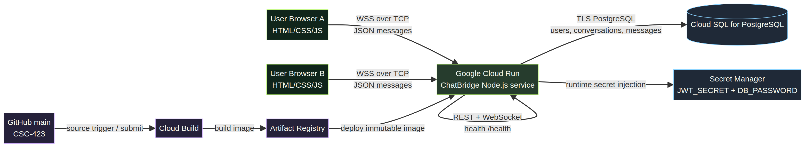

# ChatBridge GCP Deployment Package

## Target architecture

ChatBridge is designed for a single-instance Google Cloud deployment:

- **Cloud Run** hosts the Node.js service, serves the browser client and REST API, accepts WebSocket upgrades, and exposes `/health` for readiness.
- **Cloud SQL for PostgreSQL** stores users, conversations, messages, and delivery/read state.
- **Secret Manager** stores `JWT_SECRET` and `DB_PASSWORD`; secrets are injected at runtime and are never committed.
- **Artifact Registry** stores the immutable container image.
- **Cloud Build** builds the Dockerfile, pushes the image, and deploys the Cloud Run revision.
- **GitHub** contains the source and assignment documentation.

The service uses one Cloud Run instance for the in-memory user-to-socket registry. PostgreSQL is the durable source of truth; if the process restarts, users reconnect and pending messages are replayed from the database. The application is deliberately one-to-one text chat rather than an AI chatbot or a group-chat system.



Mermaid source: [cloud-architecture.mmd](cloud-architecture.mmd).

## One-time GCP setup

Use a GCP project with billing enabled and choose a region, for example `us-central1`:

```bash
gcloud config set project PROJECT_ID
gcloud services enable run.googleapis.com sqladmin.googleapis.com \
  artifactregistry.googleapis.com cloudbuild.googleapis.com secretmanager.googleapis.com

gcloud artifacts repositories create chat-repo \
  --repository-format=docker --location=us-central1
```

Create a small PostgreSQL Cloud SQL instance and database. Create the application database user and apply the repository schema:

```bash
gcloud sql instances create chat-db \
  --database-version=POSTGRES_16 --cpu=1 --memory=3840MiB \
  --region=us-central1 --availability-type=zonal

gcloud sql databases create chatdb --instance=chat-db
gcloud sql users create chatuser --instance=chat-db --password='USE_A_SECRET_MANAGER_VALUE'
```

Apply [`schema.sql`](schema.sql) using a secure PostgreSQL client connection. Do not put a password in shell history, source files, or Git.

Create runtime secrets:

```bash
gcloud secrets create jwt-secret --replication-policy=automatic
gcloud secrets versions add jwt-secret --data-file=/path/to/generated-jwt-secret
gcloud secrets create db-password --replication-policy=automatic
gcloud secrets versions add db-password --data-file=/path/to/generated-db-password
```

Grant the Cloud Run runtime service account Cloud SQL Client and Secret Manager Secret Accessor roles. Use a strong JWT secret of at least 32 characters.

## Deploy

Set the Cloud SQL connection name and the public Cloud Run origin. The first deployment may require deploying once to learn the service URL, then updating `ALLOWED_ORIGIN` and deploying again. The WebSocket implementation also supports deriving the same-origin HTTPS host when `ALLOWED_ORIGIN` is omitted.

```bash
gcloud builds submit --config cloudbuild.yaml \
  --substitutions=SHORT_SHA=$(git rev-parse --short HEAD),\
_INSTANCE_CONNECTION_NAME=PROJECT_ID:us-central1:chat-db,\
_ALLOWED_ORIGIN=https://SERVICE-URL
```

The Cloud Build file deploys with:

- `--allow-unauthenticated` for a public assignment demo
- `--timeout=3600` for long-lived WebSocket connections
- `--concurrency=80`
- `--max-instances=1` so the in-memory socket registry remains coherent
- Cloud SQL attachment
- Secret Manager injection for `JWT_SECRET` and `DB_PASSWORD`

After deployment, obtain the public URL:

```bash
gcloud run services describe chat-app --region=us-central1 \
  --format='value(status.url)'
```

Verify readiness:

```bash
curl -fsS https://SERVICE-URL/health
```

Expected response shape:

```json
{"ok":true,"service":"chatbridge","database":"postgres"}
```

## Two-user evidence procedure

1. Open the public HTTPS URL in Browser A and Browser B.
2. Register two different usernames and email addresses.
3. Log both users in. The header should move from Connecting to Connected.
4. From Browser A, select Browser B's username and send a text message.
5. Capture evidence showing the sender acknowledgement and the recipient's delivered message.
6. Send a reply from Browser B and capture the reverse direction.
7. Close Browser B, send another message from Browser A, reopen Browser B, and capture the pending message replay.
8. Record the public URL, UTC timestamp, usernames used for the demo, and screenshots with credentials redacted.

The automated repository suite covers the same protocol path in isolated memory mode: registration, duplicate protection, authentication, two-client online delivery, offline replay, history persistence, and invalid WebSocket authentication.

## Transport-layer evidence

The browser connection is WebSocket over TCP. The TCP endpoint uses the server's Cloud Run port and an ephemeral client port; WebSocket frames carry JSON application messages. TCP supplies ordered reliable byte delivery, while ChatBridge adds application-level message IDs, persistence, delivery/read status, heartbeat detection, and reconnect behavior. See [TRANSPORT_LAYER_REPORT.md](TRANSPORT_LAYER_REPORT.md) for the required TCP-vs-UDP analysis.

## Current handoff status

The source, Dockerfile, Cloud Build configuration, architecture diagram, deployment guide, and transport report are committed to GitHub. A public GCP URL and two-user screenshots require an authenticated GCP project with Cloud SQL and Secret Manager configured; do not claim those as complete until the commands above have been run successfully.
